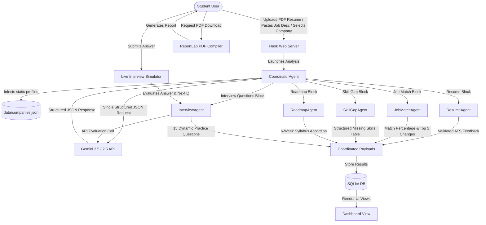

# AI Campus Placement Agent

# This project is a part of Nexus Spring of Code (NSoC) 2026 - Winter Edition
> 
[](https://github.com/deepikagandla74/ai-campus-placement-agent/actions/workflows/ci.yml)
[](https://opensource.org/licenses/MIT)
[](https://github.com/deepikagandla74/ai-campus-placement-agent/actions/workflows/ci.yml)
[](https://github.com/deepikagandla74/ai-campus-placement-agent)
[](CONTRIBUTING.md)

An AI-powered multi-agent assistant that helps students prepare for campus placements through resume analysis, job matching, personalized learning roadmaps, skill gap analysis, and interactive mock interviews.

This is an independently developed open-source application.

---

## Why is this an AI Agent System (and NOT a Chatbot)?

A typical chatbot operates as a single-turn or multi-turn conversational loop, where a single large language model (LLM) responds directly to user queries. 

In contrast, the **AI Campus Placement Agent** implements a **Coordinated Multi-Agent Architecture**:
1. **Orchestrated Workflow**: A single, central `CoordinatorAgent` receives the initial workspace context (resume, target job description, target company profiles).
2. **Task Delegation**: The coordinator executes a single structured LLM call to save token costs and prevent rate-limiting, and then delegates the resulting data subsets to specialized sub-agents.
3. **Dedicated Domain Responsibilities**: Each specialized agent is modeled as an independent Python class focusing on a single task:
   * **ResumeAgent**: Evaluates ATS formatting, experiences, strengths, and suggests grammar improvements.
   * **JobMatchAgent**: Performs keyword extraction and evaluates match percentages against the target role.
   * **SkillGapAgent**: Maps missing skills into an actionable table showing learning times, importance, and priority.
   * **RoadmapAgent**: Generates a custom 6-week curriculum with topic deep-dives and estimated study hours.
   * **InterviewAgent**: Generates tailored interview questions and handles dynamic, real-time responses scoring technical accuracy and communication.

---

## System Architecture & Workflow

For a detailed architectural breakdown including sequence diagrams of resume analysis, the multi-agent execution pipeline, interview state machines, and relational database schemas, refer to the [System Architecture Guide](docs/architecture.md). For details on secret detection and static AST vulnerability scans in CI, see the [Static Security Analysis Guide](docs/STATIC_SECURITY_ANALYSIS.md).



### Architectural Highlights

The system is engineered as a modular, decoupled pipeline designed for efficiency, resilience, and privacy:

1. **Coordinator Multi-Agent Pattern**:
   Instead of launching fragmented, repetitive LLM calls for each capability, the `CoordinatorAgent` compiles the candidate's resume text, target role requirements, and recruiter profiles into a single structured prompt. It performs one optimized call to the Gemini model, validates the payload schema, and safely decomposes the structured response into specialized sub-agents:
   - **ResumeAgent**: Evaluates ATS formatting, experiences, strengths, grammar issues, and computes an objective placement score.
   - **JobMatchAgent**: Extracts technical and domain skills, cross-referencing candidate profile keywords against job descriptions to identify matches and critical omissions.
   - **SkillGapAgent**: Prioritizes missing competencies, estimating required study hours and mapping learning resources.
   - **RoadmapAgent**: Constructs an adaptive 6-week week-by-week placement syllabus with concrete milestones.
   - **InterviewAgent**: Generates technical and behavioral question banks and powers the real-time dynamic interview evaluator.

2. **Resilient AI Gateway (`utils/gemini.py`)**:
   - Outbound API calls are wrapped in an automated retry handler with exponential backoff and randomized jitter to mitigate HTTP 429 quota exhaustion and transient 5xx server errors.
   - Strict schema validation and defensive JSON parsing prevent malformed model responses from crashing downstream agents.

3. **Privacy-First Data Flow**:
   - **Automated PII Redaction**: Strips sensitive personal identifiers (phone numbers, email addresses, street addresses) before sending resume content to external AI models.
   - **Local Persistence Only**: Analyses and practice sessions are stored locally in SQLite (`data/campus_agent.db`); uploaded resumes are stored temporarily in `uploads/` and can be cleaned up on demand.

4. **Document Validation & Security Controls**:
   - True byte-level magic signature checks (`%PDF-` for PDF, `PK\x03\x04` for Word `.docx`) reject disguised binaries and corrupted uploads.
   - In-memory sliding-window rate limiting prevents API quota exhaustion.
   - Cryptographic CSRF tokens and hardened session cookies (`HttpOnly`, `SameSite=Lax`) safeguard student sessions.

---

## Features

1. **Resume Analysis & ATS Scoring**: Extract text from PDF resumes, run grammar & style checks, identify weaknesses, and calculate a grounded ATS Score.
2. **Job Description Matching & In-Context Resume Keyword Highlighter**: Paste a Job Description to compare candidate metrics against corporate requirements, listing the exact changes needed to pass initial screenings. Inspect in-context keyword highlights across extracted resume text with whole-word matching, toggleable highlight styling, and a separate breakdown of missing keywords mapped to suggested resume sections (Skills, Projects, Experience).
3. **Skill Gap Remediation Table**: Get a prioritizing list of missing skills detailing estimated learning times, resource links, and custom project suggestions.
4. **6-Week Study Roadmap**: Access a weekly preparation calendar mapping theoretical topics, coding challenges, and revision items.
5. **Interactive Mock Interview Simulator & Timed Answer Mode**: Engage in a live, conversational chat with the Interview Agent. Answers are evaluated dynamically on technical accuracy, communication style, verbal clarity, and STAR story structure. Practice under realistic exam conditions with optional **Timed Answer Mode** featuring per-question countdowns, configurable time limits (Technical, Behavioral, HR), last-15-second visual and screen-reader accessible warnings (`aria-live`), automatic submission on expiration, and pacing telemetry included in feedback and transcripts. Keep untimed mode by default.
6. **Static Company Profiles**: Contains pre-cached interview processes, hiring guidelines, eligibility patterns, and preparation advice for 15 top campus recruiters: Google, Microsoft, Amazon, Adobe, Flipkart, Zoho, TCS, Infosys, Accenture, Capgemini, Wipro, Cognizant, Deloitte, HCLTech, and Tech Mahindra.
7. **Comprehensive Multi-Format Reports**: Generates and compiles placement readiness reports as print-ready PDF, structured GitHub Flavored Markdown (`.md`), or machine-readable JSON (`.json`) for pasting directly into personal notes, Notion, Obsidian, or external tracking systems.
8. **Dark / Light Theme Toggle**: Seamless single-click switching between light and dark modes with zero page reload, browser persistence (`localStorage`), default system preference detection (`prefers-color-scheme`), and high-contrast readability across dashboards, tables, interview chat, and study roadmaps.
9. **Placement Analysis History & Data Management**: Browse past evaluations ordered newest first, view target company, target role, and ATS scores, reopen past analyses in the dashboard view without running new AI calls, and delete stored analyses and personal data with confirmation.
10. **Privacy Notice & Consent Protection**: Transparent plain-language privacy notice (`/privacy`), required candidate consent before processing resume text via the Gemini API, optional PII redaction (masking emails, phones, and addresses), local SQLite storage, and complete account deletion options.
11. **'Try with a Sample Resume' Demo Mode**: Explore the full platform capabilities instantly without registration, login, or a Gemini API key. Loads a bundled, fictional candidate profile (Alex Chen, BS in CS from UC Berkeley) targeting a Google Software Development Engineer (SDE 1) position with pre-calculated ATS scoring, skill evidence mapping, and a 6-week preparation roadmap. A prominent "Demo data" banner marks all demo content, and demo results are never persisted to any user history or real database records.
12. **'Tell Me About Yourself' Introduction Builder & Practice Coach**: Generates tailored elevator pitch scripts from verified resume projects and target role/company context in three standard durations: 30 seconds (~65-85 words), 60 seconds (~130-160 words), and 90 seconds (~190-230 words) based on a 140 wpm conversational speaking rate. Features live-updating speaking time estimation as the text is edited, Present &rarr; Past &rarr; Future framework guidance, strict integrity enforcement against fabricating achievements not present in the resume, and an interactive practice coach that scores structure, clarity, and pacing.
13. **Campus Group Discussion (GD) Practice & AI Feedback Coach**: Master high-stakes campus placement GD rounds with an interactive practice module (`/group-discussion`). Access curated topics across **Current Affairs**, **Technology**, and **Abstract** categories, spin for random topics, write 150–250 word contributions (Opening Statement, Rebuttal, or Conclusion), and receive comprehensive multi-criteria AI feedback scoring **Content**, **Structure**, **Balance**, and **Clarity** (0–100 each). Includes high-impact alternative opening statements, key missed counter-points / blind spots, concrete strengths and improvement areas, resilient deterministic fallback evaluation, and longitudinal practice history tracking in SQLite.
14. **CTC to In-Hand Salary & Offer Comparison Calculator**: Demystifies multi-component campus placement offers by breaking down headline CTC figures into guaranteed monthly take-home pay. Evaluates fixed pay, variable incentives, joining bonuses, and employer PF across up to three offers side-by-side. Deductions are calculated using a clearly labeled, configurable assumption set stored in `data/salary_calculator_assumptions.json` (EPF @ 12% of basic, professional tax @ ₹200/mo, standard deduction of ₹75,000, and New Tax Regime slabs with Section 87A rebate and 4% cess). Highlights the Highest Monthly In-Hand Pay and Highest Guaranteed Pay to prevent students from being misled by inflated variable bonuses, rejects negative/invalid inputs, and includes a prominent disclaimer that calculations are estimates and not certified tax advice.
15. **Company-Specific Interview Preparation Tips & Contributor Data File (#541)**: Contributor-maintained company interview preparation guides stored in `data/company_interview_prep.json`. Features an interactive company selector in the mock interview preparation view, step-by-step typical hiring rounds, commonly tested technical topics, strategic preparation tips, and verified last-updated dates. All entries are clearly labeled as community-contributed, and unknown companies automatically fall back to comprehensive general placement preparation tips. New companies can be added simply by editing the JSON data file using the template in `data/company_contribution_template.json` without modifying any code.
16. **Role Skill Templates for Instant Skill Gap Analysis (#646)**: First- and second-year students who do not have a specific company job description to paste can benchmark their resume directly against standardized campus role templates (e.g. Software Developer, Backend Developer, Frontend Developer, Full Stack Developer, Data Analyst, Data Scientist, DevOps Engineer, QA Engineer, Android Developer, Cloud Engineer). Each template defines core skills, good-to-have skills, and typical industry tools in `data/role_templates.json`. Results seamlessly generate ATS scoring, skill gap prioritization, and personalized 6-week roadmaps using the existing analysis engine. New roles can be added simply by editing `data/role_templates.json` with strict schema validation enforcing required fields in CI.

---

## Feature Walkthrough & Screenshots

Here is a visual walkthrough of the core placement preparation modules:

### 1. AI Resume Dashboard & ATS Scoring
Comprehensive placement readiness dashboard displaying overall ATS match score, keyword match percentage, detected strengths, and actionable resume formatting suggestions.


#### ATS Resume Scoring Rules & Section-Wise Breakdown (#494)

The platform evaluates resumes using a **100% deterministic recruitment scoring model** out of a fixed **100-point total**. By relying on objective parsing rules rather than variable LLM temperatures, **the same resume always receives the exact same score**, while AI is reserved strictly for targeted bullet rewrites and fix suggestions.

##### Section Weights (100 Points Total)

| Section | Max Points | Evaluation Criteria |
| :--- | :---: | :--- |
| **Contact Information** | 15 pts | Valid email (+4), phone number (+4), LinkedIn profile link (+4), and GitHub / portfolio link (+3). |
| **Professional Summary** | 10 pts | Section presence (+3), ideal length of 20–120 words (+3), role intent & career focus (+2), and key technology highlights (+2). |
| **Technical Skills** | 20 pts | Section presence (+4), technical breadth (&ge;10 skills: +8; &ge;6 skills: +6; &ge;3 skills: +4), structured categorization into Languages, Frameworks, and Tools (+4), and tech stack diversity (+4). |
| **Work Experience & Internships** | 20 pts | Section presence (+4), explicit role titles (+4), dynamic action verbs in bullets (+5), quantified achievements & scale metrics (+4), and duration timelines (+3). |
| **Projects & Portfolio** | 20 pts | Section presence (+4), multiple distinct projects (&ge;2 projects: +5), explicit tech stack per project (+4), implementation action verbs (+4), and live links or measurable outcomes (+3). |
| **Education & Qualifications** | 15 pts | Section presence (+4), degree title specified (+4), recognized university or institution (+4), and graduation year / CGPA (+3). |

##### Core Resume Basics Hygiene Checks

In addition to section scores, the engine checks four fundamental resume hygiene basics:
- **Action Verbs**: Verifies that experience and project bullet points lead with dynamic power verbs (e.g. *Architected*, *Engineered*, *Optimized*, *Spearheaded*) rather than passive phrasing (*Responsible for*, *Helped with*). Passing requires at least 4 unique action verbs.
- **Quantified Achievements**: Scans for numbers, percentages, latency improvements, user scale (e.g. *improved throughput by 25%*, *5,000+ jobs/min*), and business outcomes. Passing requires at least 2 quantified metrics.
- **Consistent Dates**: Evaluates timeline formatting consistency across education and experience (e.g., standardizing on *Month Year – Month Year* or *Year – Year*) without mixing conflicting notation styles.
- **Resume Length**: Measures word count against optimal campus placement formats. The optimal single-page campus resume is **250 to 850 words**. Under 150 words is flagged as too brief; over 1,200 words is flagged as overly verbose.

##### Identifying Which Section Hurts the Resume Most ("Hurts Most")

The scoring engine calculates the point deficit (`max_score - earned_score`) across all sections. The section with the highest lost points is prominently highlighted as the **Biggest Score Drag** alongside a tailored, actionable fix suggestion so students immediately know where to invest effort to see the largest score improvement.

---

### 2. Interactive Mock Interview Simulator
Real-time conversational practice simulator with dynamic question generation, live answer evaluation, STAR technique analysis, and an optional timed countdown mode.


---

### 3. Personalized 6-Week Study Roadmap
Custom weekly preparation curriculum tailored to the candidate's target company and role, mapping daily study topics, coding problems, and mock tests.


---

### 4. Skill Gap Remediation Matrix
Detailed breakdown of identified skill gaps, detailing importance priority, estimated learning hours, project ideas, and curated documentation links.


---

### 5. CTC to In-Hand Salary & Offer Comparison Calculator
Transparent financial planning tool demystifying campus CTC offers by calculating monthly take-home pay, EPF contributions, and tax deductions with side-by-side offer comparison.


---

### 6. ATS-Friendly Resume Template Gallery & Exporter (#561)
Clean, single-column resume builder generating compliant DOCX and PDF files filled directly with the student's verified profile data.
- **3 Purpose-Built Templates**:
  - **Classic**: Traditional serif typography (Times New Roman), formal headings, and balanced margins ideal for traditional corporate and financial firms.
  - **Compact**: 1-page modern condensed layout (Calibri) with tighter spacing to fit extensive internship and project experience without overflowing.
  - **Project-Focused**: Emphasizes technical stacks, GitHub project achievements, and system design immediately after skills, optimized for technical campus screening rounds.
- **Pure Single-Column Flow**: Zero tables, columns, text boxes, or embedded images that break recruitment parser text streams.
- **Live Preview & Section Selection**: Toggle optional sections (Summary, Education, Skills, Experience, Projects, Certifications) without empty blank gaps.
- **On-the-Fly Streaming**: Compiled in-memory via `python-docx` and `ReportLab` without saving generated student resumes on disk.

---

## Tech Stack

* **Frontend**: HTML5, CSS3, JavaScript, Bootstrap 5 (Material/Glassmorphism theme)
* **Backend**: Python, Flask, SQLite (for persistence of analyses & interview sessions)
* **AI Core**: Google Gen AI Python SDK (`google-genai`), Gemini API (Central model selection: `gemini-2.5-flash`)
* **Utilities**: PyPDF2 (PDF parsing), ReportLab (PDF compiling), python-dotenv (environment variables)

---

## Folder Structure

```
AI-Campus-Placement-Agent/
│   app.py                  # Flask Application Server
│   config.py               # Path configurations & Model settings
│   prompts.py              # Central prompt registry
│   requirements.txt        # Project dependencies
│   .env                    # Environment key file (GitIgnored)
│   README.md               # Project documentation
│
├───agents/                 # Independent AI Agent classes
│       coordinator.py
│       resume_agent.py
│       job_match_agent.py
│       skill_gap_agent.py
│       roadmap_agent.py
│       interview_agent.py
│
├───data/                   # Pre-cached static profile files
│       companies.json
│
├───static/                 # Styles and JS scripts
│   ├───css/
│   │       style.css
│   └───js/
│           script.js
│
├───templates/              # HTML layout templates
│       index.html
│       dashboard.html
│       interview.html
│
├───utils/                  # Backend support utilities
│       database.py
│       gemini.py
│       pdf_reader.py
│       report_generator.py
│
├───uploads/                # Uploaded resumes (Created on runtime)
└───reports/                # Generated report PDFs (Created on runtime)
```

---

## Prerequisites & Step-by-Step Setup Guide

Follow this guide to get the application running locally on your workstation.

### Prerequisites

Ensure the following tools and accounts are set up before beginning:

| Prerequisite | Minimum Version | Verification Command | Purpose |
|--------------|:---------------:|:--------------------:|---------|
| **Python** | `3.9+` (`3.9`–`3.12` recommended) | `python --version` or `python3 --version` | Core application runtime |
| **pip** | `21.0+` | `pip --version` or `python -m pip --version` | Python package installer |
| **Git** | `2.20+` | `git --version` | Source code version control |
| **Google Gemini API Key** | Free or Paid Tier | *N/A* | Powers LLM agents ([Get a free key from Google AI Studio](https://aistudio.google.com/)) *(Optional for Demo mode)* |
| **Web Browser** | Any modern browser | *N/A* | Google Chrome, Mozilla Firefox, Microsoft Edge, Safari |

---

### Step-by-Step Installation

#### 1. Clone the Repository
Clone the project repository to your local machine:
```bash
git clone https://github.com/deepikagandla74/ai-campus-placement-agent.git
cd ai-campus-placement-agent
```

#### 2. Create a Virtual Environment
Isolate dependencies using Python's built-in `venv` module:

- **macOS / Linux**:
  ```bash
  python3 -m venv venv
  ```
- **Windows (PowerShell / Command Prompt)**:
  ```powershell
  python -m venv venv
  ```

#### 3. Activate the Virtual Environment
Activate your newly created virtual environment before installing packages:

- **macOS / Linux**:
  ```bash
  source venv/bin/activate
  ```
- **Windows (PowerShell)**:
  ```powershell
  .\venv\Scripts\Activate.ps1
  ```
  *(If you encounter execution policy restrictions on PowerShell, run `Set-ExecutionPolicy -Scope CurrentUser -ExecutionPolicy RemoteSigned` first)*
- **Windows (Command Prompt)**:
  ```cmd
  venv\Scripts\activate.bat
  ```

Your terminal prompt will now display `(venv)`.

#### 4. Upgrade pip and Install Dependencies
Install all required libraries specified in `requirements.txt`:
```bash
python -m pip install --upgrade pip
pip install -r requirements.txt
```

#### 5. Configure Environment Variables
Create your local `.env` configuration file from the provided safe template:

- **macOS / Linux**:
  ```bash
  cp .env.example .env
  ```
- **Windows (Command Prompt / PowerShell)**:
  ```cmd
  copy .env.example .env
  ```

Open `.env` in your text editor and supply your Gemini API key:
```env
FLASK_SECRET_KEY=change-this-to-a-random-secret-string
GEMINI_API_KEY=AIzaSy...your-gemini-api-key-here
```
> **Security Note**: Never commit your real `.env` file or credentials to version control. All values in `.env.example` are safe placeholders, and `.env` is ignored by Git.

#### 6. Start the Flask Application
Run the main server script:
```bash
python app.py
```
On initial startup, the SQLite database at `data/campus_agent.db` is initialized automatically if it does not already exist.

#### 7. Access the Application
Open your web browser and navigate to:
```
http://127.0.0.1:5000/
```
or
```
http://localhost:5000/
```

---

### Running in Demo Mode (No API Key Required)
Want to explore all dashboard and evaluation features immediately without configuring a Gemini API key?
1. Start the app as shown above (`python app.py`).
2. Visit `http://127.0.0.1:5000/` and click the **"Try with a Sample Resume"** button on the homepage, or navigate directly to `http://127.0.0.1:5000/demo`.
3. The platform instantly loads a complete candidate profile targeting Google SDE-1 with realistic ATS scoring, skill gap matrices, and interview simulations.

---

### Running Automated Tests & Linting
Verify your local setup by running the test suite and code quality checks:
```bash
# Run all unit and integration tests
pytest

# Run tests with verbose output
pytest -v

# Run linting checks
flake8 .
black --check .
```

---

### Optional Error Monitoring (Sentry) & Personal Data Scrubbing (#562)

To detect unhandled production errors (e.g., AI model rate limit timeouts, PDF parsing errors) without relying solely on manual log inspection, the platform includes optional Sentry integration initialized within the application factory (`create_app()`).

Monitoring is **strictly opt-in** and completely disabled unless `SENTRY_DSN` is configured.

#### Setup & Configuration

Add your project DSN to `.env`:
```env
# Optional Sentry Error Monitoring (#562)
SENTRY_DSN=https://your-public-key@sentry.io/your-project-id
SENTRY_ENVIRONMENT=production
SENTRY_RELEASE=ai-campus-placement-agent@1.0.0
SENTRY_TRACES_SAMPLE_RATE=0.0
```

#### Privacy & Personal Data Scrubbing Rules

To uphold strict student privacy guarantees, Sentry's `before_send` and `before_breadcrumb` pipelines scrub all candidate and credential data before any event is transmitted:

##### Exactly What is NOT Sent (Scrubbed)
* **Request bodies & Form Data**: Raw HTTP request payloads, form data, multipart uploads, uploaded resume text, and job descriptions are stripped (`request.data` is completely removed).
* **Cookies & Session Tokens**: HTTP cookies (`session`, `auth_session_token`, etc.) are stripped (`request.cookies` is completely removed).
* **Authorization Headers**: Sensitive HTTP headers (`Authorization`, `Proxy-Authorization`, `Cookie`, `Set-Cookie`, `X-Auth-Token`, `X-API-Key`, `X-CSRF-Token`) are stripped from `request.headers`.
* **Personal Identifiable Information (PII)**: All candidate emails and phone numbers appearing in query strings, exception messages, breadcrumb messages, or extra contexts are redacted to `[REDACTED_EMAIL]` and `[REDACTED_PHONE]`.
* **Sensitive Context Fields**: Any dictionary keys matching `resume`, `job_description`, `jd`, `email`, `phone`, `password`, `secret`, `token`, `credential`, `ssn`, `transcript`, or `bio` are replaced with `[SCRUBBED]`.
* **User Identity Context**: The Sentry `user` object is removed entirely to prevent linking exceptions to student accounts.

##### Exactly What IS Sent
* **Release Version**: Tagged as `release` (e.g. `ai-campus-placement-agent@1.0.0`).
* **Route / URL Rule**: Tagged as `route` (e.g. `/analyze`, `/interview`, `/api/aptitude/submit`).
* **Request Correlation ID**: Tagged as `request_id` (matching the `X-Request-ID` HTTP header for log correlation).
* **Sanitized Exception & Stack Trace**: Python exception class, sanitized traceback, file names, line numbers, and error message with emails/phones redacted.
* **HTTP Metadata**: Request method (`GET`, `POST`), endpoint URL path, and coarse user agent (browser/OS).

When `SENTRY_DSN` is unset or empty, Sentry monitoring remains completely inactive, makes zero network requests, and introduces zero performance overhead.

---

### Privacy-Friendly CAPTCHA Bot Protection (#653)

To safeguard registration (`/register`), login (`/login`), and password recovery (`/forgot-password`) from automated credential stuffing, mass fake sign-ups, and email-flooding bots, the application supports Cloudflare Turnstile and hCaptcha:

```env
# Supported providers: 'turnstile' (Cloudflare Turnstile) or 'hcaptcha' (hCaptcha)
CAPTCHA_PROVIDER=turnstile
CAPTCHA_SITE_KEY=0x4AAAAAA...
CAPTCHA_SECRET_KEY=0x4AAAAAA...

# Fail-Open or Fail-Closed on provider outage (default: false = fail closed)
CAPTCHA_FAIL_OPEN=false

# Require CAPTCHA always (default: true) or only after N failed attempts (0 = always)
CAPTCHA_ALWAYS_ENFORCE=true
CAPTCHA_REQUIRE_AFTER_FAILURES=0
```

- **Zero Disruption When Unset**: With no keys configured, the CAPTCHA widget remains disabled and forms submit normally.
- **Strict CSP Isolation**: The Content-Security-Policy automatically allows only the configured provider's domains (`challenges.cloudflare.com` or `hcaptcha.com`).
- **Resilient Fallback**: By default, verification fails closed on invalid/missing tokens and provider downtime, with an optional `CAPTCHA_FAIL_OPEN=true` flag for high-availability setups.

---

### Deployment & Cloud Hosting (Vercel)
The project is configured for deployment on Vercel using Python Serverless Functions (`api/index.py` and `vercel.json`):
- **Deployment Guide & Required Settings**: Refer to [docs/DEPLOYMENT_GUIDE.md](docs/DEPLOYMENT_GUIDE.md) for environment variables, architectural notes, and step-by-step instructions.
- **Pre-Flight Smoke Check**: Run `python utils/deployment_check.py` to verify deployment integrity, configuration files, and critical public routes before releasing.

### API Documentation & Versioning (#410, #445)
The platform provides a comprehensive OpenAPI 3.0.3 specification and URI-based versioning (`/api/v1/...`):
- **Interactive Swagger UI**: Explore and test endpoints at `/api/v1/docs` (or `/docs`).
- **Redoc Reference**: View 3-column structured documentation at `/api/v1/redoc` (or `/redoc`).
- **OpenAPI 3.0.3 Specification**: Raw JSON available at `/api/v1/openapi.json` (or `/api/openapi.json`).
- **API Version Discovery**: Query active and supported versions at `GET /api/v1/version` (or `/api/version`).
- **API Versioning Guide**: Read [docs/API_VERSIONING.md](docs/API_VERSIONING.md) for backwards-compatibility policies, RFC 8594 deprecation headers, and instructions for adding future versions (e.g. `v2`).

### 6. Run Resume Parser & Layout Tests
Verify resume text extraction and structured section parsing across all supported layouts (single column, two column, tables, and no section headings) with one command:
```bash
pytest tests/test_resume_parser.py
```

---

## Performance Monitoring & Latency Breakdown (#task-performance-monitoring)

To diagnose slow requests in production without risking user privacy, the application includes safe, automated performance monitoring:

- **Component Latency Breakdown**: Decomposes request duration into four distinct operational subsystems:
  - **Database (`db_duration_ms`)**: Query execution time and statement counts via monitored SQLite connections.
  - **AI Service (`ai_duration_ms`)**: Latency of upstream Gemini API calls and invocation counts.
  - **File Processing (`file_duration_ms`)**: PDF and DOCX text extraction and normalization duration.
  - **Template Rendering (`render_duration_ms`)**: Jinja template rendering duration.
- **Primary Bottleneck Identification**: Automatically diagnoses whether delays stem from the `ai_service`, `database`, `file_processing`, `rendering`, or general `application` logic.
- **W3C Server-Timing Headers**: Returns standard `Server-Timing` response headers (`total`, `db`, `ai`, `file`, `render`) for instant browser DevTools observability.
- **Admin Observability Dashboard**: Accessible at `/admin/performance` and via JSON API at `/api/admin/performance-metrics`, featuring endpoint aggregation tables, bottleneck distribution graphs, and CSV telemetry exports.
- **Strict Privacy Assurance**: Never logs or stores resume text, candidate responses, passwords, authorization tokens, or session secrets. All URL query strings are sanitized.

---

## Rate Limiting & Security Quotas

To protect quota-limited AI endpoints (Gemini API calls) from accidental exhaustion or abuse, the application includes a sliding-window in-memory rate limiter with configurable thresholds.

### Endpoint Quotas

| Endpoint / Scope | Default Limit | Purpose |
|------------------|---------------|---------|
| `/analyze` & `/api/analysis/start` (`analyze`) | `5/hour` | Resume extraction and multi-agent coordination |
| `/interview/.../submit` (`interview_eval`) | `30/hour` | Dynamic mock interview evaluations |
| `/api/interview/evaluate-star` (`star_eval`) | `30/hour` | STAR behavioral response evaluation |
| `/batch-compare` (`batch_compare`) | `10/hour` | Concurrent multi-company placement evaluation |
| `/api/generate-outreach` (`generate_outreach`) | `20/hour` | Personalized cover letter & email generation |
| Default / Other Routes (`default`) | `100/minute` | General API and UI browsing |

### Throttling Behavior

- **HTTP Status 429**: When a user or client exceeds the allowed quota, the server returns an `HTTP 429 Too Many Requests` status code with `Retry-After`, `X-RateLimit-Limit`, and `X-RateLimit-Remaining: 0` headers.
- **Friendly UI & Hints**: Browser submissions render a dedicated `429.html` cooldown page displaying a clear explanation and dynamic "try again in X minutes" (or seconds) hint with a real-time countdown.
- **JSON API Responses**: REST/AJAX endpoints return a structured JSON response:
  ```json
  {
    "success": false,
    "error": "Too Many Requests",
    "message": "You have temporarily exceeded the request rate limit for this action. Please try again in 59 minutes.",
    "retry_after_seconds": 3540,
    "retry_after_hint": "try again in 59 minutes"
  }
  ```

### Configuration (Without Modifying Route Code)

Quotas can be adjusted centrally via `.env` or in `config.py` using standard `<count>/<unit>` format strings (`second`, `minute`, `hour`, `day`):

```env
# Enable or disable rate limiting globally (true / false)
RATE_LIMIT_ENABLED=true

# Custom quotas
RATE_LIMIT_ANALYZE=5/hour
RATE_LIMIT_INTERVIEW=30/hour
RATE_LIMIT_BATCH=10/hour
RATE_LIMIT_OUTREACH=20/hour
RATE_LIMIT_STAR=30/hour
RATE_LIMIT_DEFAULT=100/minute
```

---

## Resume Upload Validation & Friendly Error Handling (#493)

To prevent application crashes, denial-of-service, blank analyses, and confusing failures from malformed uploads, comprehensive validation is enforced across client and server layers (`static/js/script.js`, `app.py`, and `utils/pdf_reader.py`) before parsing occurs:

- **Supported Formats Only**: Accepts strictly genuine PDF (`.pdf`) and Microsoft Word (`.docx`) files. Files with invalid extensions or non-matching magic byte signatures are rejected immediately.
- **Configurable File Size Boundary**: Uploads exceeding the maximum allowed size (default: **5 MB**, configurable via `MAX_UPLOAD_SIZE_MB`) are intercepted before parsing or storing to disk.
- **Scanned Image & Empty Content Detection**: Detects documents containing no extractable text (image scans, screenshots, empty pages) across both PDF and DOCX formats, explicitly explaining that scanned images are not supported and directing students to upload text-based files with selectable text or paste resume text directly.
- **Robustness Against Crashes**: Bad files, corrupt documents, or password locks never trigger uncaught 500 errors, crashes, or blank dashboards. All failure paths return clean HTTP 400 responses or helpful flash notices, and all temporary upload files are guaranteed to be cleaned up on failure.

### Upload Failure Cases & Error Messages

| Failure Case | HTTP Status | User Message |
| :--- | :---: | :--- |
| **Unsupported File Type** (e.g. `.png`, `.jpg`, `.txt`, `.exe`, no ext) | 400 / Flash | `"Unsupported file format (Invalid file format '<ext>'). Only PDF (.pdf) and Word (.docx) resumes are supported."` |
| **Oversized Upload** (> 5 MB) | 400 / 413 / Flash | `"The uploaded file exceeds the maximum allowed size of 5 MB. Please upload a smaller file."` |
| **Empty File** (0 Bytes) | 400 / Flash | `"The uploaded file is empty. Please upload a valid resume."` |
| **Scanned / Image-Only PDF** (0 text or < 100 chars) | 400 / Flash | `"The uploaded PDF appears to be scanned or image-based with no readable text. Scanned images are not supported. PyPDF2 could not extract text from this document. Please upload a text-based PDF resume or paste your resume text directly."` |
| **Blank / Image-Only Word Document** (.docx) | 400 / Flash | `"Could not extract sufficient text from DOCX document: No extractable text found. Scanned images and image-only documents are not supported. Please upload a text-based resume (PDF or DOCX) with selectable text, or paste your resume text directly."` |
| **Corrupted Document** | 400 / Flash | `"The uploaded file is not a valid PDF document. Please upload a genuine PDF resume (.pdf)."` / `"The uploaded PDF is corrupted or unreadable. Please check the file and try again."` |
| **Password-Protected PDF** | 400 / Flash | `"This PDF is password-protected. Please upload an unlocked copy of your resume or save/export the PDF without password protection, then try again."` |
| **Missing Upload & Pasted Text** | 400 / Flash | `"Please upload a supported resume file (.pdf or .docx) or paste your resume text."` |

### Configuration
```env
# Maximum allowed resume upload file size in megabytes (default: 5 MB)
MAX_UPLOAD_SIZE_MB=5
```

## Scanned & Image-Only PDF Detection

To prevent wasted AI quota and misleading evaluations from non-extractable resumes, `utils/pdf_reader.py` detects scanned or image-only PDF documents:

- **Early Halting & Quota Protection**: When an uploaded PDF yields empty text or fewer than the required characters (default: 100 characters), the analysis stops immediately before calling any Gemini LLM endpoints.
- **Actionable User Guidance**: Displays a clear notification informing the user that the document appears scanned or image-based, prompting them to upload a text-based PDF or paste resume text directly.
- **Configurable Thresholds**:
  ```env
  # Minimum extractable text characters required from a PDF resume (default: 100)
  MIN_PDF_TEXT_CHARS=100

  # Optional local OCR fallback (pytesseract). Disabled by default to avoid external dependencies.
  ENABLE_OCR_FALLBACK=false
  ```
## Gemini API Retry & Resilience

To prevent transient network glitches, 429 rate limits, and temporary 5xx server errors from failing an ongoing analysis or interview session, all outbound Gemini LLM calls in `utils/gemini.py` are protected with an automatic exponential backoff retry mechanism.

### Key Capabilities
- **Automatic Retry on Transient Errors**: Automatically retries HTTP 429 (rate limits/quota exhaustion), HTTP 500/502/503/504 (server overload/downtime), and socket/connection timeouts.
- **Fail Fast on Permanent Errors**: Non-transient errors such as HTTP 400 (bad requests), HTTP 401/403 (invalid API key or permissions), and formatting failures fail immediately without waiting or retrying.
- **Exponential Backoff with Full Jitter**: Delays scale progressively (e.g., 1s, 2s, 4s) up to a configurable maximum cap, with randomized jitter to prevent thundering herd spikes.
- **Friendly Error Messages**: When all retries are exhausted, the server logs the full error server-side and surfaces a clean, friendly message to the student (e.g., *"The AI service is busy, please try again in a minute."*). Raw tracebacks and API internals are never exposed to the user.

### Retry Configuration

Retry attempts and backoff intervals can be tuned in `config.py` or `.env`:

```env
# Maximum retry attempts before giving up (default: 3)
GEMINI_RETRY_ATTEMPTS=3

# Initial delay in seconds before the first retry (default: 1.0)
GEMINI_RETRY_INITIAL_DELAY=1.0

# Multiplier for subsequent backoff intervals (default: 2.0 -> 1s, 2s, 4s)
GEMINI_RETRY_BACKOFF_FACTOR=2.0

# Maximum upper bound delay cap in seconds (default: 10.0)
GEMINI_RETRY_MAX_DELAY=10.0

# Enable randomized jitter to avoid synchronized bursts (default: true)
GEMINI_RETRY_JITTER=true

# Request timeout in seconds on every AI call to prevent hanging (default: 30.0)
GEMINI_REQUEST_TIMEOUT=30.0
```

---

## CSRF Protection & Session Cookie Security (#300)

To safeguard student accounts, mock interview sessions, and personal career preparation records against Cross-Site Request Forgery (CSRF) and unauthorized cross-origin requests, state-changing HTTP endpoints require a per-session verification token:

### Key Capabilities
- **Per-Session CSRF Verification**: All state-changing requests (`POST`, `PUT`, `DELETE`, `PATCH`) must provide a valid CSRF token, either via the `X-CSRFToken` / `X-CSRF-Token` HTTP headers or as a `csrf_token` hidden form parameter.
- **Frontend Interceptor**: A global `fetch()` wrapper in `static/js/script.js` extracts the session token from `<meta name="csrf-token">` and automatically injects it into all AJAX / fetch requests.
- **Actionable 400 Error Handling**: Requests lacking a valid token are rejected with HTTP 400. Browser requests display a styled, informative `templates/csrf_error.html` page with clear instructions to refresh, while AJAX / API requests receive a structured JSON 400 response.
- **Hardened Session Cookies**:
  - `SESSION_COOKIE_HTTPONLY=True`: Protects session cookies from cross-site scripting (XSS) client-side reads.
  - `SESSION_COOKIE_SAMESITE="Lax"`: Restricts cross-site cookie transmission to mitigate CSRF attacks.
  - `SESSION_COOKIE_SECURE`: Automatically set to `True` when running in production (`FLASK_ENV=production` or `SESSION_COOKIE_SECURE=true`), ensuring session cookies are only transmitted over HTTPS.

### Configuration
```env
# Enable or disable CSRF protection (default: true)
WTF_CSRF_ENABLED=true

# CSRF token expiration in seconds (default: 3600 = 1 hour)
WTF_CSRF_TIME_LIMIT=3600

# Session cookie SameSite policy (default: Lax)
SESSION_COOKIE_SAMESITE=Lax

# Force secure cookies regardless of environment (default: auto-detected from FLASK_ENV)
SESSION_COOKIE_SECURE=false
```

---

## Future Scope

The following features are being considered:
* **GitHub Profile Analyzer**: Scrape repositories to grade coding quality and contribution frequency.
* **LinkedIn Profile Review**: Sync profile sections to suggest bio keywords and networking adjustments.
* **Voice Mock Interviews**: Support voice-to-text and speech analysis to grade interview tone and pace.
* **Resume Version Comparison**: Compare formatting changes across iterations to track improvement.
* **LeetCode Progress Tracking**: Import solved problem counts and display targeted coding challenges.
* **Recruiter Email Generator**: Compose cold outreach emails tailored to hiring managers.
* **Placement Calendar Integration**: Log preparation milestones directly to Google Calendar.
* **Internship Recommendation Agent**: Suggest live job posts matching analyzed skill sets.

---

## Project Status

- ✅ **Multi-Agent Architecture**: Coordinated agent system with specialized sub-agents
- ✅ **Web Interface**: Responsive Flask-based UI with Bootstrap 5
- ✅ **Resume Analysis**: ATS scoring, grammar checks, and improvement suggestions
- ✅ **Job Matching**: Keyword extraction and match percentage calculation
- ✅ **Skill Gap Analysis**: Prioritized learning paths with time estimates
- ✅ **Study Roadmaps**: 6-week customized curriculum generation
- ✅ **Mock Interviews**: Interactive interview simulator with real-time evaluation
- ✅ **PDF Reports**: Comprehensive placement readiness reports
- ✅ **CI/CD Pipeline**: GitHub Actions for automated testing and validation

---

## Behavioural Story Bank: Save STAR Stories Linked to Competencies (#687)

To help candidates master behavioral interview rounds without starting from scratch each time or forgetting their best past experiences, the platform includes a dedicated **My Stories** bank:

- **Structured STAR Framework**: Record stories organized across **Situation, Task, Action, and Result** with titles and competency tags.
- **Core Competency Tagging**: Pre-configured with core placement behavioral competencies:
  - `Teamwork` (collaboration, peer conflict resolution)
  - `Leadership` (mentoring, ownership, driving initiatives)
  - `Problem Solving` (debugging, analytical troubleshooting, overcoming obstacles)
  - `Failure` (learning from mistakes, setbacks, missed deadlines)
  - `Initiative` (proactive opportunities, innovations without being asked)
  - Custom user tags (e.g. `conflict resolution`, `deadline pressure`, `adaptability`).
- **Live Completeness & Word Count Intelligence**:
  - Live completeness indicator tracking which of the 4 STAR parts are filled (`4/4 Complete`).
  - Word count meter with recommended 150–300 word interview length benchmark (ideal for natural 2-minute answers).
- **In-Interview Prompt Integration**:
  - During mock interviews, the **"Use one of my stories"** action analyzes the current question text and surfaces matching stories ranked by relevance.
  - Serves as a **prompt/reference talking point only**—never automatically pastes or submits text, encouraging genuine vocal articulation.
- **Strict Privacy & Owner Isolation**:
  - Stories are strictly private to each candidate. Cross-user access, editing, or deletion is strictly blocked.

---

## Company Interview Cheat Sheet (One-Page Revision PDF)

To help candidates quickly revise on the way to campus drives, a downloadable one-page printable cheat sheet is available for every recruiter in `data/companies.json`:
- **One-Page Layout Guarantee**: Compact ReportLab formatting with defensive text truncation ensuring all company details fit strictly onto a single printed page.
- **Drive-Focused Content**: Includes company overview, recruitment workflow, technical and HR interview rounds, key interview topics, top required skills, and drive-day revision tips.
- **Personalized Skill Gap Targeting**: Seamlessly integrates the student's top 3 identified skill gaps for that company when previous analyses exist; skips the section cleanly and gracefully when the candidate has no analysis.
- **XML/HTML Entity Escaping**: Robust escaping prevents rendering errors and parser crashes on special symbols such as `&`, `<`, `>`, quotes, and `C++`.
- **Direct Downloads**: Accessible from the Company Explorer modal, the Companies Directory (`/companies`), and the Preparation Checklist (`/company-checklist`).

---

## Multi-Format Placement Report Exports (Markdown & JSON) (#534)

To support students who organize their placement preparation in external tools (such as Obsidian, Notion, Logseq, or local Markdown notes), the platform enables one-click exporting of the complete placement report as both **GitHub Flavored Markdown (`.md`)** and **Structured JSON (`.json`)** alongside the standard PDF export.

### Export Capabilities & Content Parity

- **Direct Download Buttons**: Download buttons for **Download as Markdown** and **Download as JSON** appear directly alongside the PDF option in:
  1. The top navigation bar on the analysis dashboard (`#btnDownloadMarkdownNav`, `#btnDownloadJsonNav`).
  2. The placement readiness summary header next to the PDF and HTML report options (`#btnDownloadMarkdownSummary`, `#btnDownloadJsonSummary`).
  3. The "Download Placement Guide" card in the bottom actions section (`#btnDownloadMarkdownCard`, `#btnDownloadJsonCard`).
  4. The dedicated on-screen HTML report view (`/report/<analysis_id>`).
- **Complete Content Parity**: Both formats export the exact same evaluation metrics presented on-screen:
  - **Readiness Scores**: Grounded ATS Compatibility Score (0–100), Section-wise Breakdown (Contact, Summary, Skills, Experience, Projects, Education), Job Match Percentage, and readiness verdict.
  - **Resume Feedback & Suggestions**: Specific identified strengths, critical weaknesses, grammar and formatting suggestions, and top 5 prioritized resume adjustments.
  - **Skill Gap Assessment**: Prioritized technical skill gaps, importance level, estimated learning times, priority rankings, recommended learning resources, and hands-on project suggestions.
  - **Interview Tips & Tailored Questions**: Drive-day interview preparation best practices, interview rounds, and tailored technical, behavioral, and HR questions gathered from analysis and roadmap modules.
  - **Six-Week Learning Roadmap**: Full weekly curriculum including theoretical topics, coding challenges, mini-projects, interview questions, and revision tasks.
- **UTF-8 & Unicode Preservation**: Non-English languages (Hindi, Devanagari, Japanese, Chinese, German, etc.), accents (`café`, `résumé`), mathematical symbols, smart quotes, and technical acronyms (`C++`, `C#`, `Node.js`) are preserved as pure UTF-8 text without ASCII escaping (`ensure_ascii=False`).

### Stable JSON Schema Specification (`v1.0`)

All JSON exports adhere to a versioned, stable JSON schema (`v1.0`):

```json
{
  "version": "1.0",
  "metadata": {
    "analysis_id": "demo-sample-analysis",
    "company_name": "Google",
    "target_role": "Software Development Engineer",
    "resume_filename": "Alex_Chen_Resume.pdf",
    "created_at": "2026-11-20 12:00:00",
    "exported_at": "2026-11-20T15:20:00.000000+00:00"
  },
  "score": 86,
  "scores": {
    "ats_score": 86,
    "job_match_score": 88,
    "readiness_verdict": "High ATS Compatibility",
    "breakdown": {
      "contact_info": 100,
      "formatting": 85,
      "experience": 90,
      "skills": 88
    }
  },
  "summary": "Candidate profile with solid foundations in algorithms, backend services, and distributed systems.",
  "overall_recommendation": "Alex is an outstanding candidate with demonstrated engineering curiosity and strong problem-solving skills.",
  "suggestions": {
    "strengths": [
      "Quantified achievements across distributed task queue and caching projects",
      "Solid foundational CS background with relevant coursework"
    ],
    "weaknesses": [
      "Limited demonstrated experience with Kubernetes container orchestration"
    ],
    "grammar_suggestions": [],
    "formatting_suggestions": [],
    "resume_changes": [
      "Incorporate 'Distributed Systems' and 'Redis In-Memory Caching' into the core skills section.",
      "Highlight Docker containerization in the project deployment summary."
    ],
    "general_recommendations": []
  },
  "skill_gaps": [
    {
      "skill": "Distributed System Design",
      "importance": "High",
      "learning_time": "3 weeks",
      "priority": "High",
      "learning_resource": "Designing Data-Intensive Applications (Martin Kleppmann)",
      "project_suggestion": "Build a distributed URL shortener or rate limiter with consistent hashing."
    }
  ],
  "interview_tips": {
    "preparation_tips": [
      "Structure behavioral responses using the STAR method (Situation, Task, Action, Result).",
      "State time and space complexity upfront before writing algorithmic solutions."
    ],
    "questions": [
      "[Technical] How does Python's GIL impact multithreaded CPU-bound vs I/O-bound tasks?",
      "[Behavioral] Tell me about a time you identified a subtle performance bottleneck in code you did not write.",
      "[HR] Walk me through your journey into computer science and what excites you about software engineering."
    ],
    "interview_rounds": [
      "Round 1: Online Technical Assessment (Data Structures & Algorithms)",
      "Round 2: Technical Problem Solving & Live Coding",
      "Round 3: Systems & Googleyness / Behavioral"
    ],
    "elevator_pitch_guidance": "Lead with your core technical competencies, cite a measurable project achievement, and articulate your direct alignment with the target company's mission."
  },
  "learning_roadmap": [
    {
      "week": "Week 1",
      "estimated_hours": 12,
      "topics": ["Advanced Data Structures", "Time & Space Complexity Analysis"],
      "coding_practice": ["LeetCode 208 (Implement Trie)"],
      "mini_projects": ["In-Memory Trie-based Autocomplete Search Service"],
      "interview_questions": ["How do you detect a cycle in a directed graph using Kahn's algorithm?"],
      "revision_tasks": ["Review BFS vs DFS traversal trade-offs"]
    }
  ],
  "advisories": []
}
```

### Direct Download & API Endpoints

| Resource Endpoint | Description |
| :--- | :--- |
| `GET /download/<analysis_id>/markdown` | Download placement report as a formatted Markdown (`.md`) attachment |
| `GET /download/<analysis_id>/json` | Download placement report as a structured JSON (`.json`) attachment |
| `GET /download/<analysis_id>?format=markdown` | Query parameter shortcut to download Markdown |
| `GET /download/<analysis_id>?format=json` | Query parameter shortcut to download JSON |
| `GET /api/analysis/<analysis_id>/export?format=json` | REST API endpoint returning structured JSON payload directly |
| `GET /api/analysis/<analysis_id>/export?format=markdown` | REST API endpoint returning Markdown string |
| `GET /api/analysis/<analysis_id>/export?format=json&download=true` | REST API endpoint initiating file download attachment |

---

## Keyboard Shortcuts & Accessibility (#691)

The platform provides a lightweight, accessible keyboard navigation layer and modal help dialog to enable efficient navigation without relying solely on the mouse:

### Global Navigation Sequences
Press <kbd>g</kbd> followed by the destination key:
- <kbd>g</kbd> then <kbd>d</kbd> : Jump to **Dashboard** (`/`)
- <kbd>g</kbd> then <kbd>i</kbd> : Jump to **Mock Interview Practice** (`/interview`)
- <kbd>g</kbd> then <kbd>t</kbd> : Jump to **Applications Tracker** (`/applications`)
- <kbd>g</kbd> then <kbd>c</kbd> : Jump to **Coding Practice** (`/coding-practice`)

### Actions & Search
- <kbd>/</kbd> : Focus the primary search input on the current page (or navigate to `/search`)
- <kbd>?</kbd> : Open the **Keyboard Shortcuts Help Dialog** (accessible with `role="dialog"`, `aria-modal="true"`, and Tab focus trapping)
- <kbd>Esc</kbd> : Close open modal dialogs or offcanvas drawers and restore focus to the triggering element
- <kbd>Ctrl</kbd> + <kbd>Enter</kbd> : Submit active form answers or run code editor problem evaluation

### Accessibility Guarantees
- **Form Protection**: All shortcuts are automatically ignored whenever focus is within an `<input>`, `<textarea>`, `<select>`, or `contenteditable` code editor.
- **Modifier Key Safety**: Shortcuts do not trigger when modifier keys (<kbd>Ctrl</kbd>, <kbd>Alt</kbd>, <kbd>Meta</kbd>) are active, preventing any conflict with browser navigation or operating system commands.
- **Screen Reader & Keyboard Friendly**: The help dialog follows WCAG 2.1 AA specifications with explicit focus traps, descriptive ARIA labels, and keyboard dismissibility.
- **REST Endpoint**: Platform bindings are also retrievable programmatically via `GET /api/shortcuts`.

---

## Privacy & Data Protection

The AI Campus Placement Agent is committed to transparent, student-friendly data practices:
* **Plain-Language Privacy Notice**: Available at [`/privacy`](templates/privacy.html) (and linked in the application footer and upload form), detailing what data is collected, where it is sent, how long it is kept, and how to delete it.
* **Mandatory AI Processing Consent**: Every resume upload requires explicit consent before any resume text is submitted to third-party AI models.
* **Third-Party AI Service**: Resume text and target role details are sent securely over HTTPS to the Google Gemini API (`gemini-1.5-flash`) solely for immediate placement evaluation and roadmap generation.
* **Optional PII Redaction**: Students can toggle automated PII masking on the upload form to strip emails, phone numbers, addresses, and government IDs prior to transmission.
* **Local Storage & Retention**: Generated analyses, ATS scores, and interview records are stored in the host's local SQLite database (`data/campus_agent.db`). Uploaded files in `uploads/` are temporary.
* **Data Erasure & Control**: Candidates can permanently delete individual past analyses on the [History](/history) page or trigger complete profile erasure via [Delete Account](/delete-account).

---

## Troubleshooting & FAQ

Here are solutions to the most common setup and runtime issues:

### 1. Port 5000 Already in Use (`OSError: [Errno 98] Address already in use` or `WinError 10048`)
- **Cause**: Another service or previous Flask instance is already running on port 5000. On macOS Monterey and later, Apple's **AirPlay Receiver** uses port 5000 by default.
- **Solution**:
  - **Option A (Run on a different port)**: Pass a custom port flag or set the `PORT` environment variable:
    ```bash
    # Run on port 5001
    python app.py --port 5001
    ```
    or via environment variable:
    ```bash
    # Linux / macOS
    PORT=5001 python app.py

    # Windows (PowerShell)
    $env:PORT="5001"; python app.py
    ```
  - **Option B (Disable macOS AirPlay Receiver)**: Go to **System Settings > General > AirDrop & AirPlay**, and turn off **AirPlay Receiver**.
  - **Option C (Terminate occupying process)**:
    - *Windows*: Run `netstat -ano | findstr :5000` to find the process ID (`<PID>`), then `taskkill /PID <PID> /F`.
    - *Linux / macOS*: Run `lsof -i :5000` to find the process ID (`<PID>`), then `kill -9 <PID>`.

---

### 2. Gemini API Key Not Detected (`GEMINI_API_KEY is not set` or `401 Unauthorized`)
- **Cause**: Flask cannot find your Gemini API key in the environment or `.env` file.
- **Solution**:
  1. Confirm your `.env` file is located in the project root directory alongside `app.py` (not inside a subfolder).
  2. Ensure the key has no enclosing quotes, extra whitespace, or brackets:
     ```env
     GEMINI_API_KEY=AIzaSy...your-actual-key-here
     ```
  3. Verify the key is enabled in [Google AI Studio](https://aistudio.google.com/).
  4. **No API key?** You can test all UI features and agent outputs instantly using **Demo Mode** (`/demo` or clicking **"Try with a Sample Resume"** on the homepage).

---

### 3. Rate Limit Exceeded (HTTP 429 Too Many Requests)
- **Cause**: You exceeded the sliding-window request limit (by default, 5 resume analyses per hour to preserve AI quota).
- **Solution**:
  - Wait for the cooldown countdown on the friendly `429` error screen.
  - For local development and testing, increase the quotas in your `.env`:
    ```env
    RATE_LIMIT_ANALYZE=100/hour
    RATE_LIMIT_INTERVIEW=100/hour
    ```
  - Or disable rate limiting completely for automated test suites:
    ```env
    RATE_LIMIT_ENABLED=false
    ```

---

### 4. Scanned or Image-Based PDF Rejected ("Unable to extract sufficient text")
- **Cause**: The uploaded resume PDF contains rasterized scans or flattened images with fewer than `MIN_PDF_TEXT_CHARS` extractable characters.
- **Solution**:
  - Export your resume directly to a text-based PDF from Google Docs, Microsoft Word, or LaTeX ("Save as PDF" / "Print to PDF").
  - Or use the **Direct Text Input** tab on the upload screen and paste your resume text directly into the form.

---

### 5. `ModuleNotFoundError` or Missing Dependencies
- **Cause**: Python packages were installed into the global Python environment instead of the project virtual environment.
- **Solution**:
  - Ensure your virtual environment is active (your prompt should show `(venv)`).
  - Reinstall requirements:
    ```bash
    python -m pip install --upgrade pip
    pip install -r requirements.txt
    ```

---

### 6. SQLite Database Errors or Corrupted State (`sqlite3.OperationalError`)
- **Cause**: A schema migration conflict or partially locked database file during local testing.
- **Solution**:
  - The SQLite database is stored locally at `data/campus_agent.db`.
  - Stop the Flask server (`Ctrl+C`), back up or delete `data/campus_agent.db`:
    ```bash
    # Linux / macOS
    rm data/campus_agent.db

    # Windows
    del data\campus_agent.db
    ```
  - Restart `python app.py`. The database and all necessary tables will be automatically recreated.

---

## Security & Dependency Management

We take application security and dependency hygiene seriously:
- **Automated Dual-Ecosystem Scans**: CI workflows audit Python (`requirements.txt`) and JavaScript (`package.json`) dependencies on every pull request and weekly schedule.
- **Maintainer Guide**: See [docs/DEPENDENCY_SECURITY.md](docs/DEPENDENCY_SECURITY.md) for step-by-step instructions on reviewing, remediating, and managing time-limited exemptions.
- **Security Policy & Responsible Disclosure**: See [SECURITY.md](SECURITY.md) for reporting vulnerabilities privately.

---

## Contributing

We welcome contributions! Please see [CONTRIBUTING.md](CONTRIBUTING.md) for guidelines.

### Quick Start for Contributors

1. Fork the repository
2. Create a feature branch (`git checkout -b feature/amazing-feature`)
3. Commit your changes (`git commit -m 'Add amazing feature'`)
4. Push to the branch (`git push origin feature/amazing-feature`)
5. Open a Pull Request

### Reproducible Local Development Seed Command (#task-seed-command)

To explore dashboards, job application pipelines, mock interviews, and reports without needing to manually upload resumes or configure API keys, contributors can populate their local setup with safe synthetic sample data:

```bash
# Seed an isolated local development database (placement_agent_dev.db)
python utils/seed_data.py
# or using Flask CLI:
flask seed run

# Run the application targeting the development database
# Linux / macOS
export DATABASE_PATH="placement_agent_dev.db" && python app.py
# Windows (PowerShell)
$env:DATABASE_PATH="placement_agent_dev.db"; python app.py

# Or seed your primary local database directly
python utils/seed_data.py --app-db
# or
flask seed run --app-db
```

#### Contributor Test Logins
- **Student Account**: `contributor.demo@seed.local` | Password: `Password123!`
- **Administrator Account**: `admin.demo@seed.local` | Password: `AdminPassword123!`

#### Data Safety & Reset
- **Clear Distinction**: All synthetic data is prefixed with `[SEED]`, uses the `@seed.local` email domain, and uses `seed_*` identifiers.
- **Inspect Seed Data Status**:
  ```bash
  python utils/seed_data.py --status
  # or
  flask seed status
  ```
- **Safe Reset**: Purges *only* synthetic seed records while leaving all user-created data intact:
  ```bash
  python utils/seed_data.py --reset
  # or
  flask seed reset
  ```

---

## Community & Support

- 🆘 [Support Guide](SUPPORT.md) - Get help and common solutions
- 🐛 [Issue Tracker](https://github.com/deepikagandla74/ai-campus-placement-agent/issues)

---

## License

This project is licensed under the MIT License - see the [LICENSE](LICENSE) file for details.

---
<div align='center'>
  
### If you find this repo helpful, please consider giving it a ⭐ star on GitHub!

</div>
